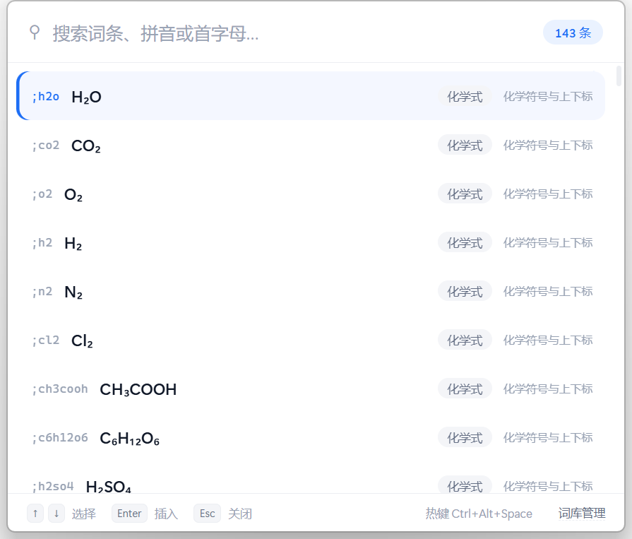
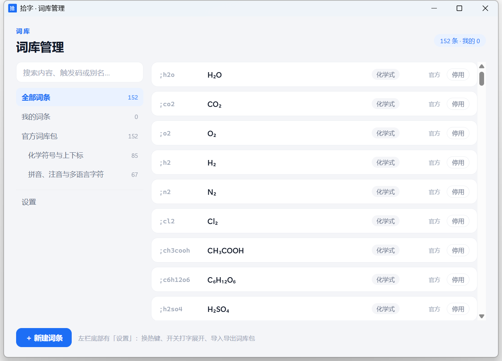

# 拾字（Shizi）

> 键盘打不出来的字，一个热键调出来。

中文写作者的取词器：**热键唤出搜索面板**，或**直接敲触发码自动展开** —— 不用写配置文件。



## 它能做什么

- **热键唤出搜索面板** —— `Ctrl+Alt+Space`。中文、拼音、首字母、别名都能搜，回车插入到唤起前的光标位置。
- **打字自动展开** —— 在任意程序里敲 `;mu` 出 μ、`;13c` 出 δ¹³C。**中文输入法下同样可用**（这是同类的拼音/输入法工具普遍做不到的）。
- **词库管理界面** —— 图形化增删改；输入内容后自动给触发码建议，并检测冲突。不需要懂 YAML。
- **词库包导入导出** —— 把自己的词库打包发给别人，对方点一下导入。
- **内置 152 条** —— 生僻字、化学式上下标、希腊字母、标点与数学符号、拼音注音。
- **托盘常驻，不联网、不上传任何内容。**



## 数据放在哪

```
<你的文档目录>\拾字数据\shizi.db
```

一个 SQLite 文件，你的全部词条都在里面 —— **想备份，直接复制走即可**。设置页里有「在资源管理器中打开」。

## 自己构建

需要 Rust、Visual Studio Build Tools（MSVC）、WebView2 运行时（Win10/11 自带）。

```bash
cd app/src-tauri
cargo build --release     # 产物：target/release/shizi.exe
```

> ⚠️ 前端（`app/ui/`）会被**编译进二进制**，改完 UI 必须重新 `cargo build` 才生效。

跑测试：

```bash
node app/tools/test_search.js      # 检索核心（归一化 / 拼音 / 触发码）
node app/tools/test_ui.js          # UI 一致性（主题 / CSS 变量 / 引用完整性）
node app/tools/test_manager.js     # 管理界面交互（视图切换 / 列表渲染）
cargo test --manifest-path app/src-tauri/Cargo.toml
```

## 为什么又做了一个

Espanso 已经是很好的开源方案，但把它交给不写配置的中文用户时，有三处卡点：

1. **要写 YAML** —— 加一个词要打开配置文件、照着格式抄、改完还要重启。
2. **要记住触发码** —— 用户得自己想"这个词叫什么、缩写该取什么"，想不出来就加不下去。
3. **中文输入法场景下的展开不稳** —— 这是个实现层面的坑（详见开发笔记）。

拾字的取舍是：**用一点内存换"零配置"**。UI 用 WebView2 渲染，所以体积和内存都比 Espanso 高：

| | 拾字 | Espanso |
|---|---|---|
| 安装体积 | 7.7 MB | 23.3 MB |
| 内存（私有工作集） | ~162 MB | ~7.2 MB |

其中约 107 MB 是 WebView2 的固定底噪，跟开几个窗口无关。

## 已知限制

- **仅 Windows**（依赖 WebView2）。
- **没有代码签名** —— 首次运行 SmartScreen 会拦一下，选「仍要运行」即可。
- 内存占用偏高（见上表），这是 WebView2 的代价。

## 目录

```
app/            应用本体
  ui/             前端（面板 / 词库管理 / 设计演示页）
  src-tauri/      Rust 端（键盘钩子、注入、SQLite 词库、托盘）
  tools/          生成脚本与测试
packs/          内置词库（JSON，触发码由 tools/normalize_packs.py 统一生成）
m0/             最早的 Espanso 原型与需求自证记录（历史存档）
PRD-v1.md       产品需求文档
perf-baseline.md 性能实测数据
```

更细的开发笔记（踩过的坑、设计取舍）见 [`app/README.md`](app/README.md)。

## 许可证

MIT，见 [LICENSE](LICENSE)。